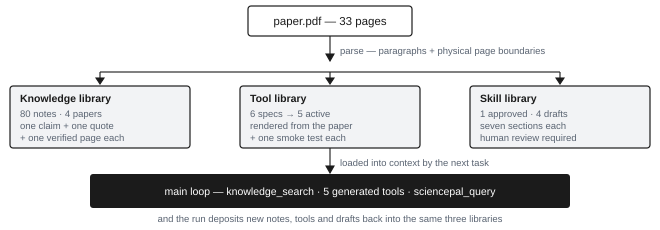
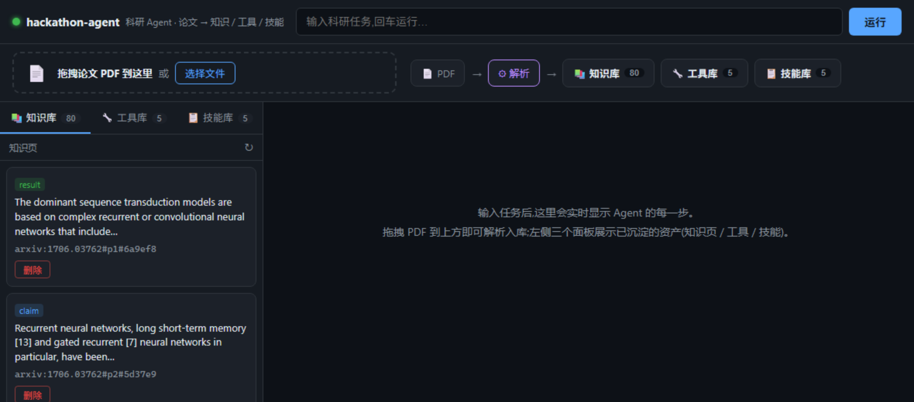
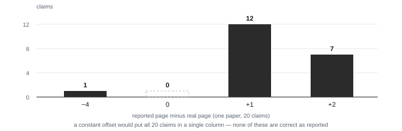

# 03b · Project Description — Science Agent Coworker Hajimi

*Global AI4Science Hackathon 2026 · Track: AI Agent · five pages, one argument per page.*

## 1. The problem: papers are read, knowledge is not kept

A researcher entering a new subfield reads twenty to fifty papers. Six months later, three things are
gone.

1. **Provenance.** The conclusion survives in memory; the page it came from does not. "Something in
   that paper improved accuracy by eight points" cannot be checked in time for a rebuttal.
2. **Method.** The method was described in Section 3.2 and then re-implemented by three groups,
   independently, each with its own bugs.
3. **Judgement.** Which claims are load-bearing and which are incidental lives in one person's head —
   and leaves when that person does.

Existing tools attack retrieval (search over a corpus) or summarisation (a longer answer). Both are
read-only in an architectural sense: ask, receive, forget. Neither leaves behind an **asset** — an
artefact that persists, carries its own provenance, and is consumed by the next task instead of being
re-derived from scratch.

That gap is what this project builds into.

> What if reading a paper left the *repository* richer, not just the conversation?

**Who it is for.** Graduate students and early-career researchers in computational fields; PIs and
systematic-review teams who have to defend where a claim came from. **The scenario we designed
against:** twenty papers, one group meeting on Thursday, and a summary that someone will question.

| | Chat assistant (today) | This system |
|---|---|---|
| What it leaves behind | an answer, in a conversation | notes, tools and skills on disk |
| Provenance | "the paper says so" | verbatim quote + verified page |
| Reuse | re-ask, re-read | next task loads them into context |
| Auditability | none | every artefact reviewable and diffable |

<!-- pagebreak -->

## 2. What we built: a loop that leaves residue

{w:88}

**The loop.** A DeepSeek-backed agent loop with an explicit tool registry: `knowledge_search` (query
the notes), the five generated method tools, `sciencepal_query` (deep reading of paper text), plus file
and shell primitives. Every run is traced into `logs/runs/<id>/` and can be replayed offline.

**Where SciencePal sits.** Not as a wrapper and not as a chat window: one tool node inside our loop,
called over three endpoints (`agent/initiate`, `agent-run/{id}/stream`, `agent-run/{id}`). It performs
the close reading and returns claims carrying verbatim quotes; our code verifies each quote against the
PDF's own text layer and decides what may enter the knowledge base. Be precise about the boundary: the
tool path takes paper *text* (up to 8,000 characters per call), while full-PDF runs go through the same
three endpoints from a script that uploads the file — both yield the identical claim-and-quote structure.
Output is consumed programmatically, never pasted into a document.

**What the libraries hold.** Atomic notes (one claim, one verbatim quote, one verified page, one
confidence level); TypeScript tools rendered from a paper's method paragraph; seven-section skills —
domain map, procedure, method-to-tool mapping, failure modes, terminology, evidence index, negative
constraints.

{w:80}

**The point.** The agent is not the product; the libraries are — the deposit is what compounds.

<!-- pagebreak -->

## 3. Two decisions that are hard to copy

### 3.1 Provenance is constructed, not reported

We asked a capable reading agent for page numbers. On one paper (ReAct, 20 claims) **all 20 were
wrong**, and not by a constant offset (+1 in 12 cases, +2 in 7, −4 in 1) — so no arithmetic
correction exists. The quotes, by contrast, were locatable 20 of 20 times.

A second paper reproduced it: Transformer (18 claims), 1 page number right, +1 offset in 16 of 18.
Pooled: **38/38 quotes locatable, 1/38 page numbers correct.**

{w:58}

Two readings, one entire class of design removed: *no field that the model reports about itself is
taken on trust.* Pages are matched from the quote against the PDF's own page boundaries, with a
three-level degradation (full sentence → 30 characters → 16) because PDF extraction splits math spans
into loose tokens. **99.7%–100%** locate rate over 80 notes.

This is not a feature that can be added late: it fixes the data model (the quote is the anchor, the
page is derived), the failure policy (an unlocatable note is stored at `low` confidence and logged),
and the interface (every note shows its quote beside its page).

### 3.2 Tools are grown, not hand-written

A general coding agent ships forty-odd hand-written tools. We ship six that nobody wrote. `toolsynth`
extracts a `MethodSpec` from a paper's method paragraph — carrying the evidence page — validates it
against a schema, renders TypeScript from a template and generates its smoke test. When no verified
implementation exists in the L1 catalogue, the tool degrades to a parameter template for a human to
complete, and says so. It never emits plausible-looking code.

### 3.3 Governance is a runtime gate, not a convention

Four rules are enforced in code rather than documented: a page must be anchored; a claimed failure
mode needs at least three samples; a parse quality below 0.7 is quarantined instead of ingested; and a
skill cannot become `active` without a named human reviewer. Drafts sit in a separate queue, because a
skill that silently becomes active is a skill nobody checked.

### 3.4 What this costs us

Two costs, stated rather than hidden. **Ingestion cannot invent.** Anchoring needs a text layer: a
scanned page, or a paraphrase instead of a quote, produces no note at all — we lose 0.3% of claims
rather than mint a wrong citation. **Ingestion spends no tokens.** Extraction is deterministic rules,
not a model call per note, so the ingest runs offline at no cost; the trade is that a note's description
is its source sentence, not a rewrite.

## 4. What we verified — and what verifying it caught

| Claim | Measurement | How to reproduce |
|---|---|---|
| Test suite | **378 passing, 0 failing**, 94 suites, 8.1 s | `npm run verify` |
| Knowledge library | **4 papers → 80 notes** (77 high / 3 medium) | `node src/main.ts ingest fixtures/papers` |
| Anchoring | **99.7%–100%** of notes located to a real page | same command, per-paper rate printed |
| Tool library | 6 specs → **5 active** + 1 parameter template | `node src/main.ts tools doctor` |
| Skill library | **1 approved + 4 drafts** | `node src/main.ts skills list` |
| Dependencies | **2 runtime** (`zod`, `pdfjs-dist`), 0 agent frameworks | `package.json` |

Numbers are cheap; the more useful claim is that the loop found real defects. Three were closed:

1. **Self-reported pages, 1 of 38 correct.** Closed by the anchoring module (§3.1) — and by accepting
   that a quote, not a page number, is the only thing a model reliably produces.
2. **Half sentences from streaming.** SciencePal emits incremental `chunk` events alongside its final
   message. Taking the last assistant message blindly yields a truncated quote, which then anchors to
   nothing and silently lowers yield. We now accept only terminal (`stream_status ≠ chunk`) text.
3. **Arithmetic that cannot be wrong, and was.** A generated `success_rate(11, 10)` returned "110%" —
   valid syntax, impossible semantics, and it passed its smoke test because the test used only legal
   inputs. We added cross-field validation plus a regression test (`test/toolsynth/validation.test.ts`).

The third generalises: a tool that *runs* but computes nonsense is worse than no tool, because it
looks like a capability.

**Reproducible without a key.** The 80 notes are frozen in `fixtures/knowledge/`, so both data and
interface can be inspected with no API key, no network and no ingestion run:

```bash
KNOWLEDGE_DIR=fixtures/knowledge node src/main.ts web
```

<!-- pagebreak -->

## 5. Limitations, and what we would do next

A submission at this stage that claims no limitations would not be credible, so here is the list.

| Limitation | Consequence | Next step |
|---|---|---|
| Table and figure extraction returns empty arrays | Result-type claims carry their numbers in tables — exactly the claims hardest to anchor; the residual 0.3% failure concentrates here | Convert tables to Markdown before extraction; highest-value single fix |
| PDF title cleaning | Titles such as `REAC T : SYNERGIZING…` reach the interface | Per-line font-metric normalisation |
| One method has no verified implementation | `normalize_answer` ships as a parameter template | Grow the verified-implementation catalogue |
| Page-number finding covers two papers (38 claims) | It settles a design question; it does not estimate an error rate | Repeat across the four-paper set and report the distribution |
| Web interface runs locally only | Judges cannot click the product without running it | Reviewer package plus the recorded demo; no public deployment, so a stray click cannot consume the API budget |
| `sciencepal_query` takes text, not a file | One call cannot read a whole PDF; full-paper runs need the script | Move `files[]` upload into the tool, so node and script share one path |
| No user study | We cannot claim usability findings | Five structured sessions with target users |

**With another month.** Tables first — it unblocks the result half of the knowledge library, the half
that a reviewer is most likely to test. Then file uploads into `sciencepal_query`, so the loop can hand
over a whole PDF instead of a text window. Then cross-paper consensus: the schema already carries an
evidence count and the rule "a single-paper method must be labelled as such", but no skill in the
current set has three independent papers behind it, so the mechanism is implemented and unexercised.
Then a review workbench, so that the draft queue is something a person can work through rather than a
folder of markdown files.

**What we would not change.** The refusal to trust model-reported structure. Every defect we found
this week was a variant of that one, and the whole architecture follows from it.
