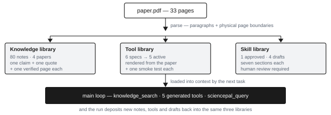
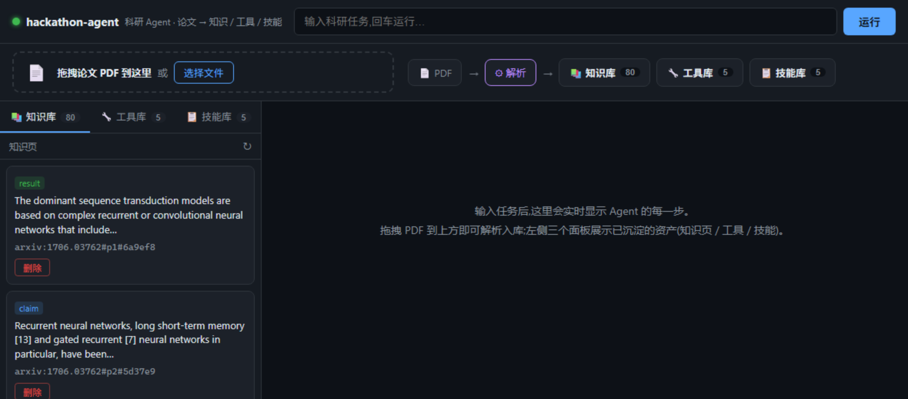
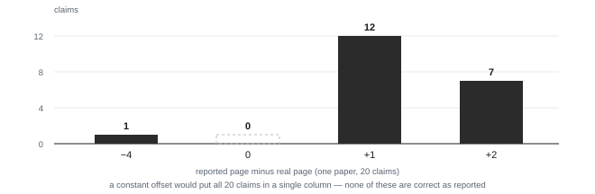

# 项目说明 —— Science Agent Coworker Hajimi（中文审阅版）

*Global AI4Science Hackathon 2026 · 赛道：AI Agent · 共五页，每页一个论点。*

> 本文件是 `03b-project-description.en.md` 的逐段对照译稿，**仅用于组内审查，不提交**。
> 英文版与中文版一一对应（同为 5 节），文末「审阅备注」列出需要你们确认的判断。

## 1. 问题：论文读完了，知识没留下

一个刚进入某个子领域的研究者，会读二十到五十篇论文。六个月后，三样东西会消失。

1. **出处。** 结论留在记忆里，页码没有。答辩或反驳时，"那篇论文里好像有个方法把准确率提高了八个点"这句话，来不及核实。
2. **方法。** 方法写在论文 3.2 节，然后被三个组各自独立重写一遍，各自带着自己的 bug。
3. **判断力。** 哪些论断是承重的、哪些是顺带一提的，只存在一个人的脑子里——这个人走了，判断就没了。

现有工具针对的是检索（在语料上搜索）或摘要（给出更长的答案）。从架构上说，两者都是只读的：提问、得到回答、忘记。它们都不会留下**资产**——一种能持久存在、自带出处、并能在下一次任务中被直接消费而不是被重新推导的产物。

这个缺口就是本项目的着力点。

> 如果读完一篇论文，变富的是**仓库**，而不只是对话，会怎样？

**面向谁。** 计算领域的研究生与青年科研人员；必须为"这句话出自哪里"负责的 PI 和系统综述团队。**我们设想的场景：** 二十篇论文，周四组会，以及一份一定会被追问的总结。

| | 今天的对话式助手 | 本系统 |
|---|---|---|
| 留下什么 | 一段对话里的答案 | 磁盘上的知识页、工具与技能 |
| 出处 | "论文里说的" | 逐字 quote + 核实过的页码 |
| 复用 | 重新提问、重新阅读 | 下次任务直接载入上下文 |
| 可审计性 | 无 | 每个产物都可复核、可比对 |

<!-- pagebreak -->

## 2. 我们做了什么：一个会留下沉积物的循环

{w:88}

**主循环。** 一个由 DeepSeek 驱动、带显式工具注册表的 agent 循环。注册表里挂着 `knowledge_search`（检索知识页）、5 个生成出来的方法工具、`sciencepal_query`（深度文献精读），以及文件与 shell 原语。每次运行都落到 `logs/runs/<id>/`，因此一次会话可以在无网络的情况下离线回放。

**SciencePal 在什么位置。** 它既不是套壳，也不是一个聊天窗口：它是我们主循环内的**一个工具节点**。我们调用它的三个端点（`agent/initiate`、`agent-run/{id}/stream`、`agent-run/{id}`）。SciencePal 负责精读，返回带逐字 quote 的论断；我们的代码再把这些 quote 拿到 PDF 自身的文本层上校验，并决定什么可以进入知识库。**边界要说准**：工具通道收的是论文**文本**（单次上限 8,000 字符），整篇 PDF 则由同一组三个端点的脚本上传发起；两条路产出的是同一种"论断 + quote"结构。产物是被程序消费的——从不手工粘贴进文档。

**三个库。**

- **知识库** —— 4 篇论文的 80 条原子知识页。每条一颗论断、一段逐字 quote、一个核实过的页码、一个置信度。
- **工具库** —— 从论文中抽出的 6 个方法规格，渲染成 TypeScript，其中 5 个通过 smoke test 转为 active，1 个有意扣下未发。
- **技能库** —— 七节操作手册：领域地图、标准流程、方法到工具的映射、常见失败模式、术语消歧、证据索引、负向约束。1 个已审核，4 份草案。

{w:80}

**要点。** Agent 不是产品，三个库才是；agent 只是往库里存东西的方式，而**存下来的东西才会复利**。

<!-- pagebreak -->

## 3. 两个不容易被抄走的决定

### 3.1 出处是构造出来的，不是报出来的

我们向一个能力足够的阅读 agent 索要页码。在一篇论文上（ReAct，20 条论断），**20 条全错**，且不是恒定偏移（+1 出现 12 次、+2 出现 7 次、−4 出现 1 次）——因此不存在任何算术补偿。相比之下，quote 本身 20 条全都能定位到。

第二篇论文复现了同一个现象：Transformer（18 条论断），**只有 1 条页码正确**，+1 偏移占了 18 条里的 16 条。两篇合并：**38/38 条 quote 可定位，1/38 条页码正确。**

{w:58}

两次阅读，就排除了一整类设计：**模型关于自身输出的任何字段，都不予采信。** 页码由 quote 在 PDF 自身的分页边界上匹配得出，采用三级退化（整句 → 前 30 字符 → 前 16 字符），因为 PDF 抽取会把数学表达打散——论文里写在一行的式子，抽出来是几个松散的 token。80 条知识页的定位率是 **99.7%–100%**。

这不是一个可以"后期加上"的特性。它决定了数据模型（quote 是锚，页码是派生值）、失败策略（定位失败的笔记仍然入库，置信度降为 `low`，并留痕待审）、以及界面（每条笔记都把 quote 摆在页码旁边）。

### 3.2 工具是长出来的，不是手写的

一个通用编码 agent 会附带四十来个手写工具。我们给的六个工具，没有任何人写过。`toolsynth` 从论文的方法段落抽出 `MethodSpec`（携带证据页），按 schema 校验，用确定性模板渲染成 TypeScript，并为产物生成 smoke test。当 L1 实现目录里没有可验证的实现时，工具降级为"参数模板 + 人工填写"，并且**明确说明自己降级了**。它绝不输出看着像是对的代码。

### 3.3 治理是运行时闸门，不是约定

四条规则由代码执行，而不是写在文档里：页码必须锚定；声称的失败模式至少要有三个样本；解析质量低于 0.7 的论文被隔离而不是入库；技能没有具名的人类审核人不得转为 `active`。草案单独排队，因为一个悄悄变成 active 的技能，等于没人审过。

### 3.4 这套做法要付的代价

两条代价，我们说清楚而不是藏起来。**入库不能凭空编。** 锚定只在 PDF 带文本层时成立：扫描页、或阅读 agent 改写而非逐字引用的论断，产出的结果就是"没有这条笔记"。我们宁可丢掉一条论断，也不愿制造一条错误引用——在本语料上这个损耗是 0.3%，在扫描版语料上会高得多。**入库不花 token。** 抽取是文本层上的确定性规则，不是每条笔记一次模型调用，所以四篇论文的入库在无网络、无单条成本的情况下完成。代价是：笔记的描述取自源句而非重写，因此没有任何超出原文的压缩。

<!-- pagebreak -->

## 4. 我们验证了什么——以及验证抓出了什么

| 主张 | 实测量 | 复现方式 |
|---|---|---|
| 测试 | **379 通过 / 0 失败**，95 个 suite，11.0 秒 | `npm run verify` |
| 知识库 | **4 篇论文 → 80 条知识页**（77 high / 3 medium） | `node src/main.ts ingest fixtures/papers` |
| 锚定 | **99.7%–100%** 的知识页定位到真实页码 | 同上，会逐篇打印定位率 |
| 工具库 | 6 个规格 → **5 个 active** + 1 个参数模板 | `node src/main.ts tools doctor` |
| 技能库 | **1 个已审核 + 4 份草案** | `node src/main.ts skills list` |
| 依赖 | **2 个运行时依赖**（`zod`、`pdfjs-dist`），零 agent 框架 | `package.json` |

数字是廉价的，所以更有价值的说法是：这套测量回路抓出了真实缺陷。其中三个被发现并修掉：

1. **自报页码，38 条只对 1 条。** 由锚定模块（§3.1）解决——同时也接受了一个事实：模型可靠产出的只有 quote，不是页码。
2. **流式输出里的半截句子。** SciencePal 在最终消息之外还会发增量 `chunk` 事件。不加区分地取最后一条 assistant 消息，会得到被截断的 quote，而截断的 quote 谁也锚不上，只会悄悄拉低产出率。现在只采纳终态（`stream_status ≠ chunk`）的文本。
3. **一个不可能算错的算术，错了。** 生成的 `success_rate(11, 10)` 返回了 "110%"。语法合法、语义不可能，而且**通过了它的 smoke test**——因为测试只用了合法入参。我们在模板层补了跨字段校验，并加了回归测试（`test/toolsynth/validation.test.ts`）。

第三条的意义超出这个工具本身：一个**能跑但算错**的生成工具，比没有这个工具更糟，因为它看起来像一项能力。

**不需要 key 也能查看数据与界面。** 80 条知识页冻结在 `fixtures/knowledge/`，因此无需 API key、无需网络、无需跑入库，就能查看数据与界面：

```bash
KNOWLEDGE_DIR=fixtures/knowledge node src/main.ts web
```

要真跑一遍循环则不同，而且只是部分不同：入库一篇 PDF 仍然不需要 key（见 §3.4，抽取是规则而非逐条调模型）；提问才需要自备两个 key，仓库里不含任何密钥——`DEEPSEEK_API_KEY`（主循环用）、`SCIENCEPAL_API_KEY`（仅 SciencePal 工具节点用）。费用由使用者自己的账号承担。

<!-- pagebreak -->

## 5. 局限，以及接下来会做什么

一个在这个阶段宣称自己没有局限的提交，是不可信的，所以列在这里。

| 局限 | 后果 | 下一步 |
|---|---|---|
| 表格与图片抽取返回空数组 | 结果类论断的数字都在表格里——恰恰是最难锚定的一类；残余的 0.3% 失败集中在这里 | 抽取前先把表格转 Markdown；单项收益最高 |
| PDF 标题清洗 | 诸如 `REAC T : SYNERGIZING…` 的标题会漏到界面上 | 按行做字体度量归并 |
| 有一个方法没有可验证实现 | `normalize_answer` 以参数模板形式发布 | 扩充"可验证实现"目录 |
| 页码结论覆盖两篇论文（38 条） | 它能回答设计问题，不能估计错误率 | 在四篇论文上重跑，报告分布 |
| Web 界面只在本地运行 | 评委不自己跑起来就点不到产品 | 评审包 + 录屏；不做公网部署，避免误点消耗 API 额度 |
| `sciencepal_query` 收文本、不收文件 | 单次调用读不完整篇 PDF；全文精读得走脚本 | 把 `files[]` 上传做进工具，让节点与脚本共用一条路径 |
| 没有用户研究 | 我们不能声称任何可用性结论 | 与目标用户做五场结构化访谈 |

**如果再多一个月。** 先做表格——它解锁的是知识库的结果那一半，也正是评委最可能去验证的那一半。然后给 `sciencepal_query` 加上文件上传，让主循环能直接交一整篇 PDF，而不是一段文本。再之后做跨论文共识：schema 里已经有"支持论文数"这个字段，也有"单篇方法必须标注为单篇"的规则，但当前没有一份技能背后真有三篇独立论文支撑，所以这套机制**实现了但没被跑过**。最后是审核工作台，让草案队列变成一个真能处理的队列，而不是一个装着 markdown 的文件夹。

**我们不会改的一件事。** 不采信模型自报的结构。这一周里我们找到的每一个缺陷，都是这件事的变体，而整个架构都是从它推出来的。

---

## 审阅备注（不提交，只给你们看）

**1. 五页是硬约束，我按"每页一个论点"手动分页。**
构建脚本新增了 `<!-- pagebreak -->` 标记，PDF 现在**恰好 5 页**（不是自动分页碰巧 5 页）。如果你们后续增删内容，改完重跑 `node scripts/build-submission-pdf.mjs 03b`，页数变化会立刻暴露——**超过 5 页就违规**，请务必复核。

**2. 三个需要你们确认的地方：**

| # | 我的写法 | 风险 | 建议 |
|---|---|---|---|
| 1 | §3.1 "向一个能力足够的阅读 agent 索要页码" | 已测两篇:ReAct 20 条 + Transformer 18 条,合并 38 条,自报页码 1/38 正确、quote 38/38 可定位、+1 偏移占 28/38。**不要**在答辩时改口成"模型普遍如此" | 保留两篇口径。若被问样本量,答"两篇 38 条,足以否掉一个做法,仍不足以估错误率" |
| 2 | §3.4 "在扫描版语料上会高得多" | 这是**推断**，不是实测。我们没跑过扫描版 PDF | 若无把握，可删这半句，不影响论证 |
| 3 | §4 "8.1 秒" | 这是本机实测的测试耗时，不同机器会不同 | 保留但答辩时别当成性能指标；换成"8 秒量级"更稳 |

**3. 我刻意没写的东西（别在答辩时补上）：**

- **没有写"跨论文共识已跑通"。** schema 和规则都在，但没有一份技能真有三篇独立论文支撑（见 §5）。写了就是虚假陈述。
- **没有写"用户测试""用户反馈"。** 我们没做过。
- **没有写检索延迟毫秒数。** 早期大纲里有个"3–8ms"，我找不到原始测量记录，所以删掉了。如果你们现场能测出来再加，别凭印象写。
- **没有写"支持任意学科"。** 只在 4 篇 ML 论文上验证过，说"流水线与学科无关"已经是上限。

**4. 这一页与 ①④ 的分工。** ① 是"我们是谁、解决什么问题"，④ 是"用了谁的资源、哪些是赛前成果"。**③-b 不重复这两件事**，只讲：问题怎么定义（§1）、系统怎么搭（§2）、哪儿是新的（§3）、拿什么证明（§4）、还差什么（§5）。如果你们发现三份材料有说法不一致，以 ④ 的事实清单为准。

---

## 本轮补充说明（2026-10-31 14:05，新增）

**1. 加了 3 张图，因为官网对"项目说明"的要求是「用文字和图表系统地阐述」。**
之前五页只有文字、表格和一张 ASCII 流程图，严格说不算"图表"。现在：

| 图 | 位置 | 作用 | 数据来源 |
|---|---|---|---|
| `fig-arch.svg` | 第 2 页 | 技术方案：一条从 PDF 到三个库再回到主循环的流程 | 系统实际结构 |
| `fig-ui.png` | 第 2 页 | 产品实拍：面板上 80 / 5 / 5 与知识页卡片 | 本机 `node src/main.ts web` 真实截图，非合成 |
| `fig-anchor.svg` | 第 3 页 | 验证结果：20 条论断的页码偏移分布 | `fixtures/reading/react-2210.03629.anchor-verify.json` |

**2. 界面上那三个数字是当场跑出来的，不要改。** 截图里显示 `知识库 80 / 工具库 5 / 技能库 5`，
与正文、与 ① ④ 的口径一致。若之后重建了知识库导致条数变化，**必须重截**，否则图文不符。

**3. 中文版比英文版长。** 英文版为压进 5 页做了文字压缩（删掉了"三个库"的 bullet，因为图里已有），
中文版保留完整表述供你们审阅。三张图两边完全一致。

**4. 版面是硬约束，不是碰巧。** 加图后一度溢出到 6 页，靠三步压回 5 页：图宽按 `{w:NN}` 百分比控制、
删掉与图重复的 bullet、压掉 3.4 的两句话。**后续任何人改文字，都必须重跑
`node scripts/build-submission-pdf.mjs 03b` 并确认页数仍是 5。**
