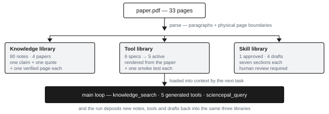
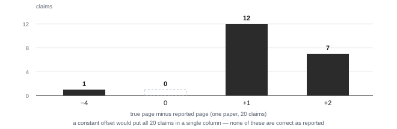

# hackathon-agent — Project Report

### 科研搭子·哈基米 (Research Buddy Hachimi)

| | |
|---|---|
| **Competition** | Global AI4Science Hackathon 2026 · AGENT Track |
| **Project** | A research-domain Agent that distills papers into reusable knowledge / tools / skills |
| **Team** | 4 members |
| **GitHub** | https://github.com/xingshuai01/hackathon-agent |
| **SciencePal Agent** | https://sciencepal.ai/agents/ae5aaadf-41c2-41e1-9b33-dbe5b8d6226e |

---

## Abstract

Research knowledge does not accumulate: a paper is read once, and its methods are rarely reused. We present **hackathon-agent**, a research-domain agent that turns each paper into three reusable assets — atomic knowledge pages that carry a verbatim quote and the page on which that quote was actually found, executable tools generated from method paragraphs, and seven-section skills distilled across papers. On four papers the system yields 80 knowledge pages, 5 active tools and 5 skills, each of them traceable to a source page. The design is driven by a measurement rather than a preference: of 38 claims checked, all 38 quotes could be located in their PDF while only one of 38 model-reported page numbers was correct — so the quote, not the page number, is made the anchor.

---

## 1. Executive Summary

Researchers are drowning in papers: knowledge is fragmented, methods are not reproducible, and "I read it once but can't use it" is the norm. **hackathon-agent** attacks this by turning every paper into three reusable assets:

| Module | Question | Output |
|---|---|---|
| **A · Knowledge Base** | *What does it say?* | Atomic, evidence-backed claims, each pinned to an exact page anchor |
| **B · Tool Library** | *How do I do it?* | Executable tools auto-generated from paper methods, with smoke tests |
| **C · Skill Library** | *What should I do?* | Cross-paper consensus distilled into seven-section skills, human-reviewed |

The system is a **self-hosted agent loop** (DeepSeek via native `fetch`, zero SDK) with **SciencePal as a first-class tool node** in the main loop — satisfying the hackathon's mandatory "substantive use of SciencePal" requirement.

---

## 2. Team Contributions

### 2.1 WANG Xingshuai — Team Lead (Architecture / Skeleton)

- Designed the **6-layer architecture** (entry → UI → orchestration → tools → services → state) and froze 6 interface contracts to allow three teammates to build modules in parallel without collision.
- Built the **agent core**: main loop (`src/agent/loop.ts`), tool registry, system prompt, and the three-stage tool pipeline (`safeParse → validateInput → call`).
- Built the **Web UI** (thin-shell server + frontend): drag-and-drop PDF parsing, the visualized workflow, three library panels with delete, and the mascot.
- **SciencePal integration**: `sciencepal_query` tool node, SSE stream parsing, and created the custom "论文精读官" (Paper Close-Reader) agent on the platform.
- **LLM layer**: DeepSeek client (streaming, retry, zero SDK), plus the full **offline replay** capability (`--record` / `--replay`) so the demo survives network failure.
- **Engineering discipline**: 34 recorded decisions (`docs/DECISIONS.md`), automated rule checks, and the `npm run verify` gate (typecheck + rules + 379 tests).

### 2.2 WAN Yihui — Module A (Knowledge Base, ~2,200 lines)

- Built `src/services/knowledge/`: extraction, local Markdown store, index, two-stage retrieval (keyword + LLM refine), ingest, and anchoring.
- Implemented **atomic knowledge pages**: one claim per page, classified into claim/method/result/limitation/definition.
- Implemented **page anchoring**: the model never reports page numbers (empirically 0/20 correct); instead, a verbatim quote is reverse-located to the real page with 100% hit rate.
- Enforced the data iron law: no `paperId + page` anchor → not admitted to the knowledge base.
- **SciencePal API analysis** (`docs/wyh/`): probed the platform's agent / run / stream endpoints and fixed module A's evidence contract — quotes are reliable, page numbers are not.
- **Submission delivery**: authored the project-info (01), project-description (03b), originality statement (04) and video script, recorded the demo video, and compiled this report.

### 2.3 SUN Peng — Module B (Tool Library, ~2,600 lines)

- Built `src/services/toolsynth/`: method extraction, tool generation, rendering, smoke testing, and a doctor report.
- Implemented **method → executable tool**: papers' methods become typed, validated, callable tools (`buildTool` + zod schema + deterministic implementation).
- Added cross-field validation (e.g. `success_rate` rejects `successes > total`) and fail-closed behavior (a failing tool never crashes the process).
- Enforced the data iron law: no `evidencePage` → method not admitted to the tool library.

### 2.4 ZHOU Yixuan — Module C (Skill Library)

- Built `src/services/skills/`: store, matching, manifest, generation, injection, and the seven-section structure.
- Implemented **seven-section skills** (applicability / workflow / criteria / failure modes / parameters / evidence / don'ts) with consensus grading (`evidence:3` for practices supported by ≥3 papers).
- Implemented skill matching that loads the right skill into the agent's context per task.
- Enforced the data iron law: a skill is never activated until it is human-reviewed (`reviewedBy`).

---

## 3. Development Process

The project was built in a **4-day sprint** (deadline 2026-10-31 23:59 HKT).

### 3.1 Day 1 — Architecture & Contracts
- Wrote `AGENTS.md`, `SRS`, `SDD`, and `DECISIONS.md` (the "why" documents).
- Froze the 6 interface contracts and the message format (DeepSeek/OpenAI — not Anthropic).
- Stood up the agent loop skeleton and the `npm run verify` pipeline.

### 3.2 Day 2–3 — Three Modules in Parallel
- XHH-Coco, aqiu, and B1eberz built Modules A, B, C **independently** against the frozen contracts.
- The team lead integrated SciencePal (DEC-032: SciencePal as a tool node, not a dev tool), the DeepSeek client, and the thin-shell Web UI.
- The offline replay capability was added so the live demo can never fail to a network outage.

### 3.3 Day 3–4 — Hardening & Submission
- Full code review of each module; fixed cross-field validation and sandbox-compat defects.
- Built the Web UI: drag-drop PDF parsing → visualized workflow → three library views.
- Created the custom SciencePal Agent and verified it end-to-end (3 atomic claims, verbatim quotes).
- `npm run verify` all green: **379 tests pass, 0 fail**.
- Produced submission materials (project info, description, originality statement, video script) and the mascot.

---

## 4. Architecture

```
entry (CLI / Web)
  -> UI (event bus -> SSE / terminal renderer)
    -> orchestration (agent loop, tool registry)
      -> tools (knowledge_search, sciencepal_query, generated tools)
        -> services (knowledge / skills / toolsynth / paper / llm)
          -> state (local Markdown store, fixtures cache, trace writer)
```

- **LLM**: DeepSeek (`deepseek-v4-pro` / `deepseek-v4-flash`), native `fetch`, streaming with retry.
- **SciencePal**: the main loop calls `sciencepal_query`, which invokes our custom Agent on the platform — this is the "substantive use" of SciencePal.
- **Thin-shell Web**: `web/` only imports `node:*` and the event bus; all business logic is injected from `main.ts`.

Figure 1 shows what one ingest buys: the paper is parsed once, and the main loop then reads from three libraries instead of from the raw document.



---

## 5. Usage Instructions

### 5.1 Prerequisites
- **Node.js 24** (runs `.ts` directly).
- **DeepSeek API key** — https://platform.deepseek.com/api_keys
- *(optional)* **SciencePal API key** — for `sciencepal_query`.

### 5.2 Setup
```bash
npm install            # add --cache ./.tools/npm-cache if npm complains about cache permissions
cp .env.example .env   # fill DEEPSEEK_API_KEY (and optionally SCIENCEPAL_API_KEY)
```

### 5.3 CLI
```bash
node src/main.ts ingest <paper.pdf|dir>   # paper → knowledge pages (A) + skill draft (C)
node src/main.ts ask "<task>"             # run the agent (live)
node src/main.ts ask "<task>" --replay    # offline replay (zero network)
node src/main.ts web --fake               # start the Web UI at http://127.0.0.1:7777
node src/main.ts tools doctor             # tool health report
node src/main.ts skills list|check|promote
```

### 5.4 Web UI
1. Open http://127.0.0.1:7777.
2. **Drag a PDF** into the drop zone, click **Start Parsing**.
3. A dialog shows what was distilled into A (knowledge) / B (tools) / C (skill draft).
4. Click the three **library buttons** to view / delete knowledge pages, tools, and skills.
5. Type a task in the top bar to run the agent end-to-end.

### 5.5 Offline Demo (recommended for the live pitch)
```bash
node src/main.ts ask "Summarize the method of this paper" --record   # record responses
node src/main.ts ask "Summarize the method of this paper" --replay   # replay, zero network
```

### 5.6 Verify
```bash
npm run verify    # typecheck + rule check + 379 tests
```

---

## 6. Results at a Glance

Table 1 summarises the state of the submitted repository; each row names the command that re-derives it.

| Asset | Result | Re-derive with |
|---|---|---|
| Knowledge library | 4 papers → 80 atomic notes (77 high, 3 medium confidence) | `ingest fixtures/papers` |
| Tool library | 6 method specs → 5 active tools, each smoke-tested | `tools doctor` |
| Skill library | 1 approved skill + 4 drafts, seven sections each | `skills list` |
| Page anchoring | 38 of 38 quotes located; 1 of 38 reported pages correct | `fixtures/reading/*.json` |
| Claim retention | 0.3% of candidate claims dropped (no quote, no note) | ingest log |
| Test suite | 379 tests, 0 failures, about ten seconds | `npm run verify` |

---

## 7. Testing & Validation

### 7.1 Automated checks
- **379 automated tests** (typecheck, six rule groups, unit and integration), 0 failures; `npm run verify` runs the whole gate in about ten seconds and needs neither a key nor a network.
- The rule checker is mechanical rather than advisory: it enforces the dependency allow-list and the import boundaries (the Web shell may not import business code), so architectural drift fails the build instead of being caught in review.

### 7.2 Evidence: how a page number is established

We gave a capable reading agent a paper and asked, per claim, which page it came from. None of the 20 answers matched the PDF, and the misses were not a constant shift either: measured as the true page minus the reported page, the gap was +1 in twelve claims, +2 in seven and −4 in one (Figure 2) — the answer was usually one or two pages too early, but not always. A post-hoc correction therefore does not exist: adding one page to every answer would fix twelve claims and leave eight wrong.



We therefore stopped asking and started searching. Each claim's verbatim quote is normalised and matched against the PDF's own page text: first inside a ±2-page window around the reported page, then document-wide, degrading from the whole quote to its first 30 and then 16 characters. All 20 quotes were located. A second paper reproduced the result — Transformer, 18 claims, one page number correct, a +1 offset in 16 of 18. Pooled over both papers: 38 of 38 quotes locatable, 1 of 38 page numbers correct.

The failure path is defined rather than silent: a note whose quote cannot be located is still stored, but at `low` confidence and with the miss written to a rejected-candidates log, so the library can be audited instead of trusted. Of the 80 notes shipped here, 77 are high confidence and 3 medium.

### 7.3 SciencePal Agent Verification
- **SciencePal Agent** verified end-to-end: close-reading produced 3 atomic claims with verbatim quotes and no invented page numbers.

---

## 8. Key Design Decisions & Constraints

1. **SciencePal as a tool node (DEC-032)** — SciencePal is a first-class tool in our own main loop, not a dev tool for writing docs.
2. **Zero SDK** — DeepSeek and SciencePal are called via native `fetch`; no langchain/openai/agent frameworks.
3. **Frozen contracts** — 6 interface files are immutable; parallel work never collides.
4. **Four data iron laws** — no page anchor → not in knowledge; no evidence page → not in tools; parse quality < 0.7 → quarantined; skill not human-reviewed → not active.
5. **Thin-shell Web** — the Web layer carries no business logic.
6. **Offline replay** — the whole demo can run with zero network.

---

## 9. Limitations & Future Work

- **Tables and figures are not extracted.** Result-type claims carry their numbers in tables, which is exactly where the residual 0.3% anchoring failure concentrates; converting tables to Markdown first is the highest-value single fix.
- **No cross-paper synthesis yet.** The schema carries `supports / contradicts / extends` links, but they are sparsely populated; cross-library contradiction detection is future work.
- **The Web shell is single-user and unauthenticated**: a demonstration surface, not a deployment. Hosting it needs per-user isolation and authentication first.
- **Skill promotion is manual by design.** A skill never becomes active without human review, so the library grows at human speed — coverage traded for trust, deliberately.
- **PDF-only input.** Pages without a text layer are rejected rather than OCR'd, so scanned papers are out of scope today.
- **Tool synthesis covers deterministic method specifications.** Methods that require training or GPUs are described in the library but not executed.

---

## 10. Links

Code and documentation: https://github.com/xingshuai01/hackathon-agent. The SciencePal agent the loop calls: https://sciencepal.ai/agents/ae5aaadf-41c2-41e1-9b33-dbe5b8d6226e. A recorded demo thread: https://sciencepal.ai/projects/-/thread/8c01b81f-56b9-4905-bdae-00a203757cbb.
